# Architecture: "The Closer" — Cold Email Writer + Send Bot

> Sprint 3 · Agent Meets Gmail

---

## 1. High-Level System Overview

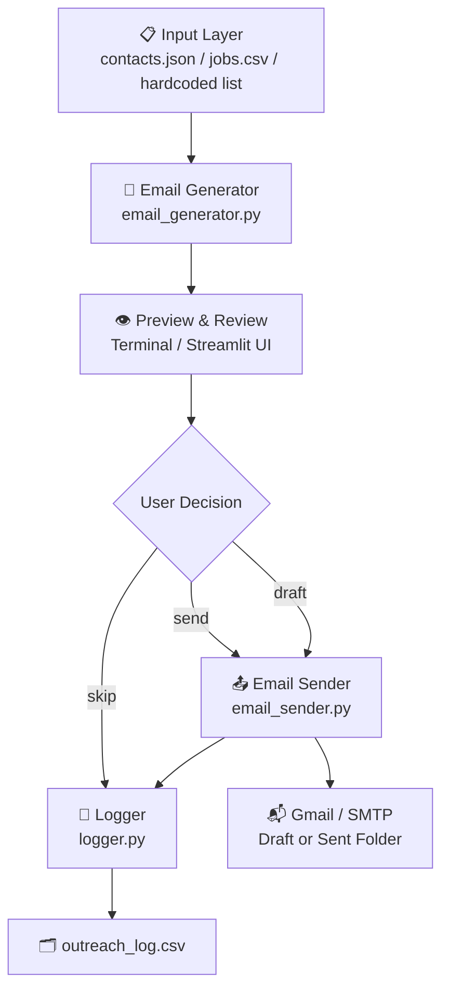

---

## 2. Layered Architecture

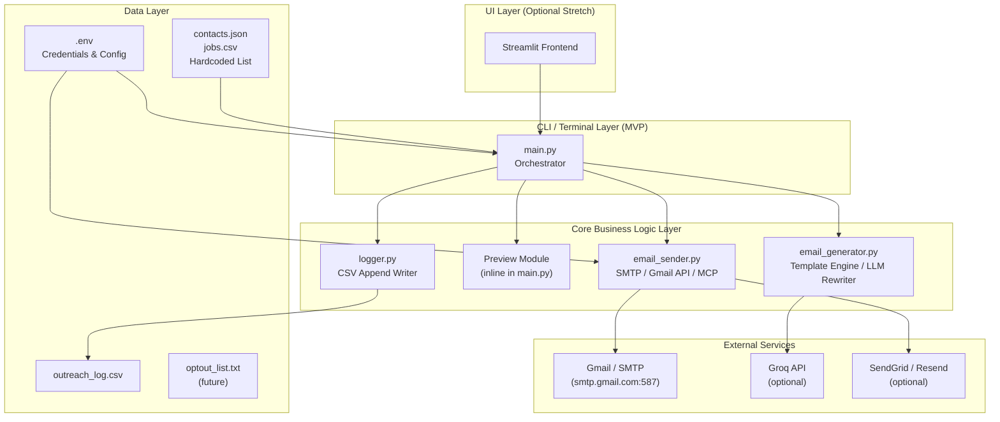

---

## 3. Component Breakdown

### 3.1 `main.py` — Orchestrator

The central controller that wires all components together.

**Responsibilities:**
- Load outreach targets from the configured input source
- Iterate over each contact record
- Call `email_generator.generate_email(contact)` for each record
- Display email preview in terminal
- Prompt user for: `send / draft / skip`
- Dispatch to `email_sender.send()` or `email_sender.draft()`
- Pass result to `logger.log_entry()`

**State machine per contact:**

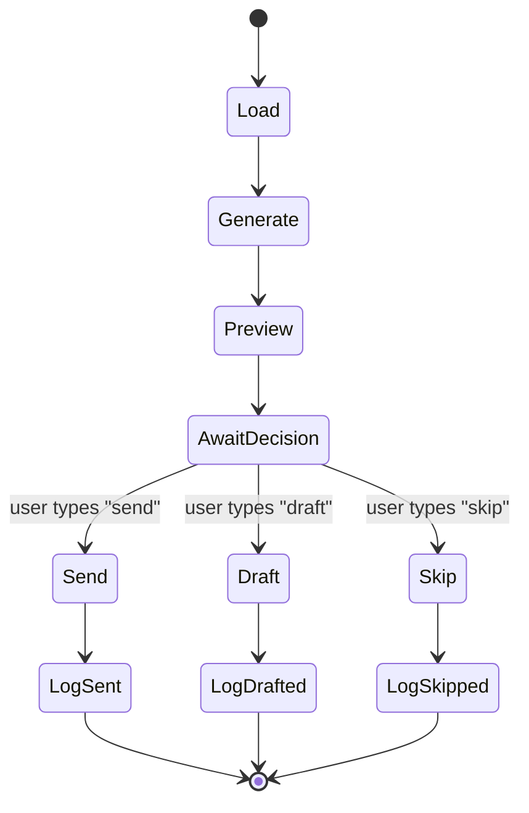

---

### 3.2 `email_generator.py` — Email Generation Engine

Accepts a single contact record dict and returns a `(subject, body)` tuple.

**Two-tier generation strategy:**

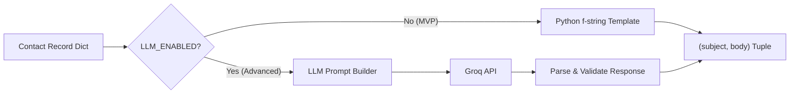

**Email structure enforced (≤150 words):**

| # | Section | Source Field |
|---|---------|-------------|
| 1 | Subject Line | `role`, `company` |
| 2 | Personalization Hook | `personalization_note` |
| 3 | Intro | `candidate_name`, `candidate_background` |
| 4 | Value/Fit Statement | `role`, `candidate_background` |
| 5 | Clear Ask | hardcoded CTA |
| 6 | Sign-off | `candidate_name`, `portfolio_url` |

**Key functions:**
```python
def generate_email(contact: dict) -> tuple[str, str]:
    """Returns (subject, body)"""

def build_prompt(contact: dict) -> str:
    """Builds LLM prompt with personalization constraints"""

def validate_email(body: str) -> bool:
    """Checks word count, presence of CTA, no fake claims"""
```

---

### 3.3 `email_sender.py` — Delivery Engine

Abstracts the actual sending mechanism behind a unified interface.

**Sending modes:**

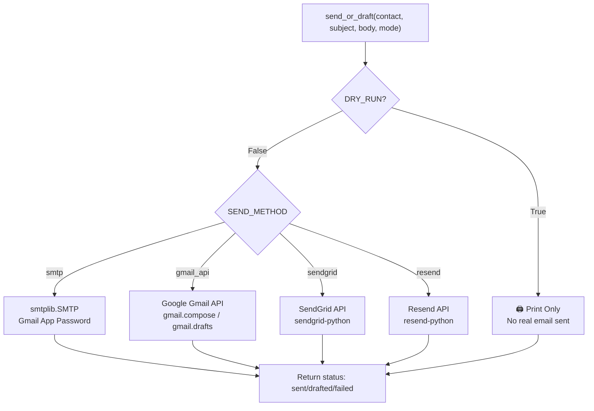

**Key functions:**
```python
def send_email(to: str, subject: str, body: str) -> dict:
    """Sends via configured provider. Returns status dict."""

def create_draft(to: str, subject: str, body: str) -> dict:
    """Creates Gmail draft. Returns draft ID."""

def get_smtp_connection() -> smtplib.SMTP:
    """Establishes authenticated SMTP session."""
```

**SMTP auth flow:**
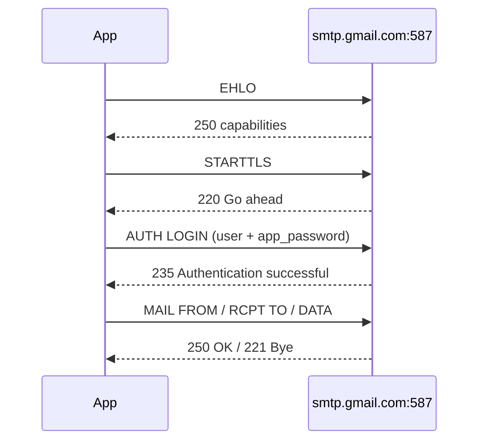

---

### 3.4 `logger.py` — Audit Trail

Appends a row to `outreach_log.csv` after every action.

**Log schema:**

| Column | Type | Description |
|--------|------|-------------|
| `timestamp` | ISO 8601 | When the action occurred |
| `recipient_email` | string | Target email address |
| `company` | string | Target company |
| `role` | string | Job role title |
| `subject` | string | Generated subject line |
| `status` | enum | `generated` / `drafted` / `sent` / `skipped` / `failed` |
| `error_message` | string | Error detail if failed, else empty |
| `word_count` | int | Word count of generated email body |

**Key functions:**
```python
def log_entry(contact: dict, subject: str, status: str, error: str = "") -> None:
    """Appends one row to outreach_log.csv"""

def get_log_summary() -> dict:
    """Returns counts by status for session summary"""
```

---

## 4. Data Flow — End-to-End

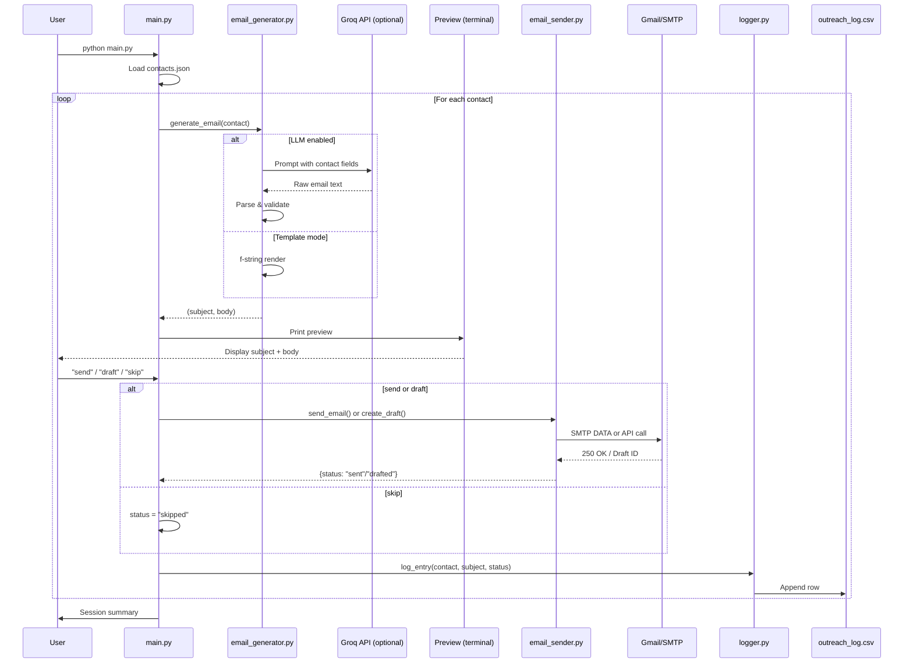

---

## 5. Input Schema

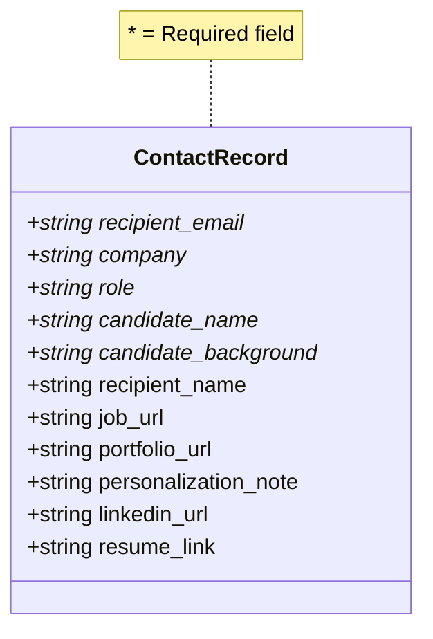

---

## 6. Output Schema

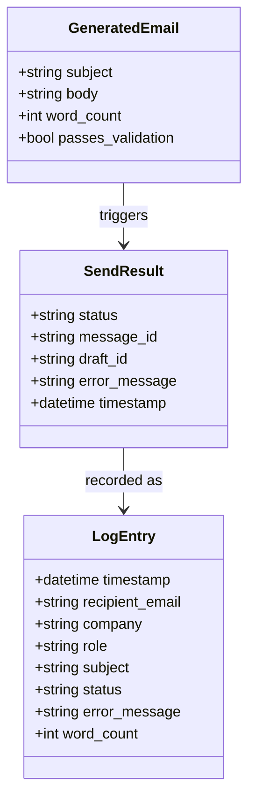

---

## 7. Configuration & Environment Variables

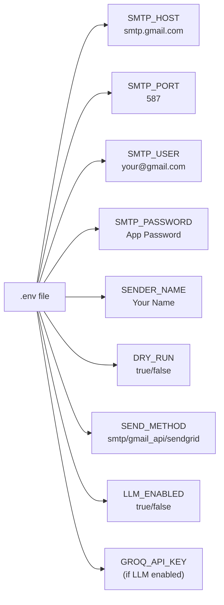

> [!CAUTION]
> Never commit `.env` to version control. The `.env.example` template (without secrets) should be committed instead. Gmail requires App Passwords (not your account password) when using SMTP with 2FA enabled.

---

## 8. Safety & Ethics Guardrails (Architecture-Level)

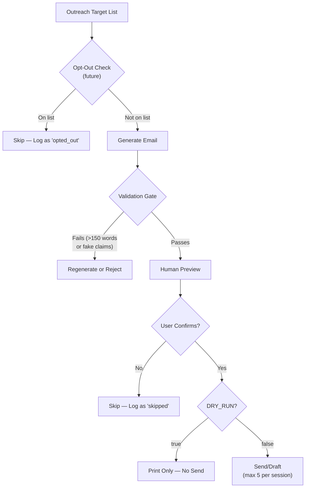

---

## 9. Folder Structure (Detailed)

```text
the-closer/
│
├── main.py                  # Orchestrator — load, loop, confirm, dispatch
├── email_generator.py       # Template + LLM email generation
├── email_sender.py          # SMTP / Gmail API / SendGrid abstraction
├── logger.py                # CSV audit log writer
│
├── contacts.json            # Input: list of outreach target records
├── jobs.csv                 # Alt input: CSV format contacts
│
├── outreach_log.csv         # Output: per-attempt audit log (auto-created)
│
├── .env                     # Secret credentials (NOT committed)
├── .env.example             # Template for .env (committed)
├── .gitignore               # Excludes .env, __pycache__, etc.
│
├── requirements.txt         # pip dependencies
└── README.md                # Setup + usage instructions
```

---

## 10. Dependency Map

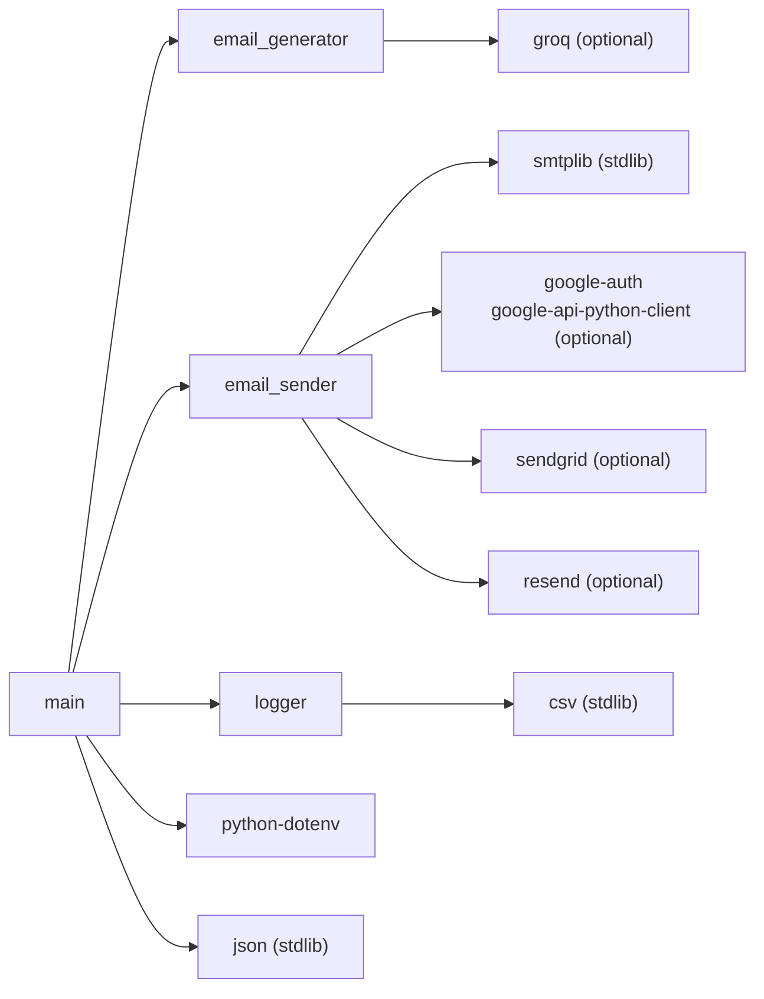

**`requirements.txt` (minimal MVP):**
```
python-dotenv
```

**`requirements.txt` (full optional stack):**
```
python-dotenv
groq
google-auth
google-auth-oauthlib
google-api-python-client
sendgrid
resend
streamlit
```

---

## 11. MVP vs. Stretch Goal Feature Matrix

| Feature | MVP | Stretch |
|---------|-----|---------|
| Hardcoded contact list | ✅ | — |
| `contacts.json` input | ✅ | — |
| `jobs.csv` input | — | ✅ |
| Python f-string template | ✅ | — |
| LLM-powered rewriting | — | ✅ |
| Email word count validation | ✅ | — |
| Terminal preview + confirm | ✅ | — |
| Streamlit UI | — | ✅ |
| SMTP sending | ✅ | — |
| Gmail Draft creation | — | ✅ |
| Gmail API sending | — | ✅ |
| SendGrid / Resend | — | ✅ |
| `DRY_RUN` mode | ✅ | — |
| CSV audit logging | ✅ | — |
| Opt-out list | — | ✅ |
| Follow-up generator | — | ✅ |
| Email quality scorer | — | ✅ |
| Spam-risk checker | — | ✅ |
| Deduplication | — | ✅ |

---

## 12. Sprint Build Sequence (Teachable Steps)

```mermaid
gantt
    title Sprint 3 Build Sequence
    dateFormat  X
    axisFormat Step %s

    section Foundation
    Sample contacts data        :done, s1, 0, 1
    email_generator.py template :done, s2, 1, 2

    section Core Loop
    Preview in terminal         :active, s3, 2, 3
    Confirm prompt (yes/no)     :s4, 3, 4

    section Delivery
    SMTP send (DRY_RUN=true)    :s5, 4, 5
    CSV logger                  :s6, 5, 6

    section Validation
    Turn off DRY_RUN, test send :s7, 6, 7
    Show proof in Gmail         :s8, 7, 8
```

---

> [!NOTE]
> This architecture is intentionally layered so that each module can be built, tested, and explained independently in a live Cursor session. The `DRY_RUN` flag makes it safe to demo the full pipeline without sending real emails until the final step.
