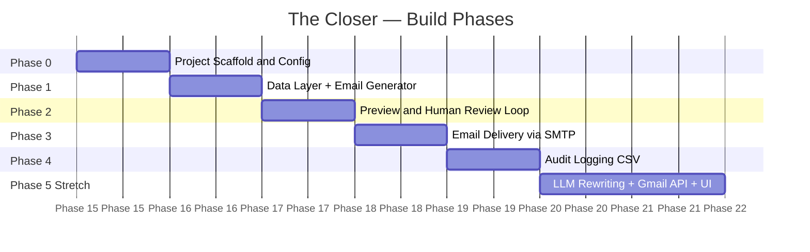
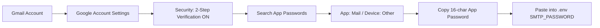
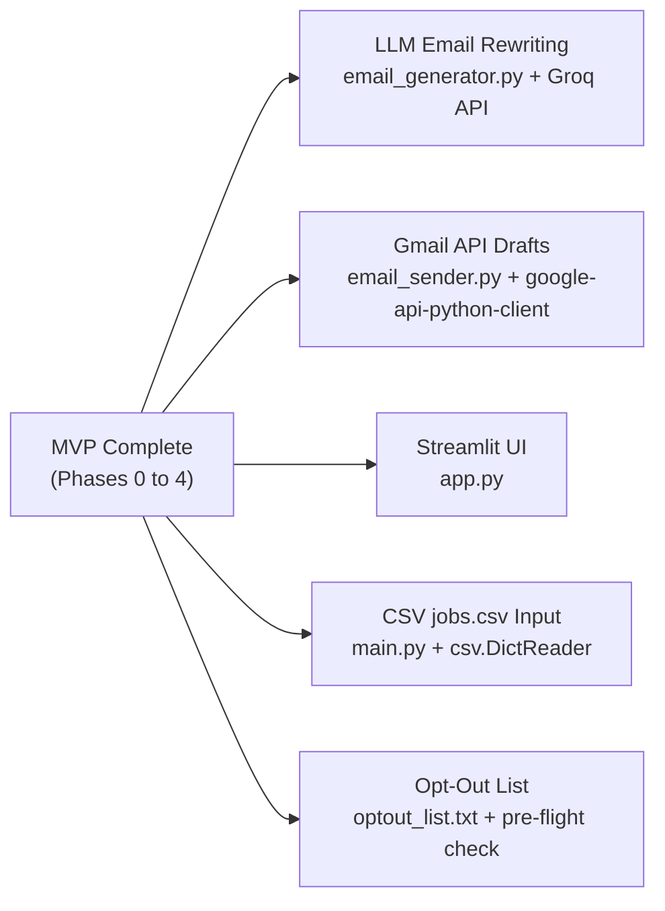
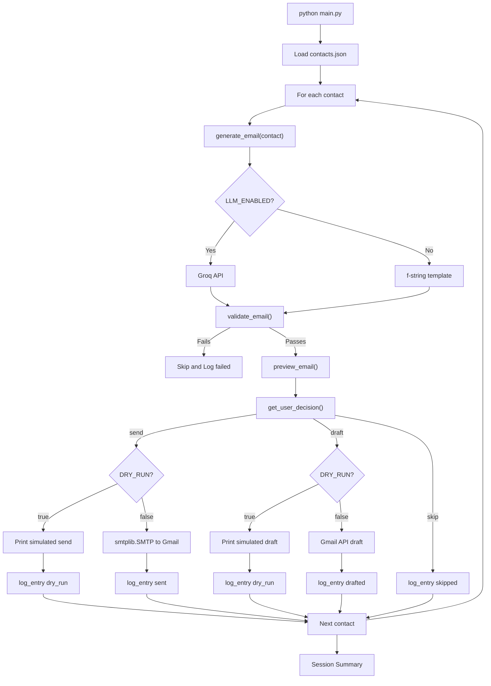

# Phase-Wise Implementation Plan
# "The Closer" — Cold Email Writer + Send Bot

> **Sprint 3 · Agent Meets Gmail**
> Sources: [architecture.md](file:///Users/harsh/Desktop/Project/Cold%20Email%20Parser/architecture.md) · [problemStatement.md](file:///Users/harsh/Desktop/Project/Cold%20Email%20Parser/problemStatement.md)

---

## Phase Overview



---

## Phase 0 — Project Scaffold & Configuration

> **Goal:** Empty repo → runnable project skeleton with all files in place and secrets managed safely.

### Files Created

| File | Purpose |
|------|---------|
| `the-closer/` | Project root |
| `main.py` | Entry point (stub) |
| `email_generator.py` | Generator module (stub) |
| `email_sender.py` | Sender module (stub) |
| `logger.py` | Logger module (stub) |
| `contacts.json` | Sample contact data |
| `.env.example` | Credential template |
| `.env` | Real credentials (gitignored) |
| `.gitignore` | Excludes secrets + cache |
| `requirements.txt` | Dependency list |
| `README.md` | Setup instructions |

### Step-by-Step Tasks

#### 0.1 — Create the project folder structure

```bash
mkdir the-closer && cd the-closer
touch main.py email_generator.py email_sender.py logger.py
touch contacts.json requirements.txt README.md .env .env.example .gitignore
```

#### 0.2 — Populate `.gitignore`

```gitignore
.env
__pycache__/
*.pyc
outreach_log.csv
*.egg-info/
.DS_Store
```

#### 0.3 — Populate `.env.example`

```env
SMTP_HOST=smtp.gmail.com
SMTP_PORT=587
SMTP_USER=your_email@gmail.com
SMTP_PASSWORD=your_app_password_here
SENDER_NAME=Your Name
DRY_RUN=true
SEND_METHOD=smtp
LLM_ENABLED=false
GROQ_API_KEY=
```

#### 0.4 — Populate `requirements.txt`

```
python-dotenv
```

#### 0.5 — Install dependencies

```bash
pip install -r requirements.txt
```

#### 0.6 — Add stubs to each module

**`main.py` stub:**
```python
"""The Closer — Orchestrator"""
from dotenv import load_dotenv
load_dotenv()

def main():
    print("The Closer is starting...")

if __name__ == "__main__":
    main()
```

### Phase 0 Acceptance Criteria

- [ ] `python main.py` runs without errors and prints the startup message
- [ ] `.env` is NOT tracked by git (`git status` shows it as untracked/ignored)
- [ ] All 4 module files exist with docstrings

---

## Phase 1 — Data Layer + Email Generator

> **Goal:** Load outreach targets → generate a personalized `(subject, body)` tuple for each contact.

### Files Modified

| File | Changes |
|------|---------|
| `contacts.json` | 3–5 sample contact records |
| `email_generator.py` | f-string template engine + word-count validator |
| `main.py` | Load contacts + call generator + print raw output |

### Step-by-Step Tasks

#### 1.1 — Define sample contacts in `contacts.json`

Minimum required fields: `recipient_email`, `company`, `role`, `candidate_name`, `candidate_background`.

```json
[
  {
    "recipient_name": "Priya Sharma",
    "recipient_email": "priya@acmeai.com",
    "company": "Acme AI",
    "role": "Backend Engineering Intern",
    "job_url": "https://acmeai.com/jobs/backend-intern",
    "personalization_note": "Acme AI recently launched an AI workflow automation product",
    "candidate_name": "Alex Chen",
    "candidate_background": "Python developer with experience in automation and AI agents",
    "portfolio_url": "https://github.com/alexchen"
  },
  {
    "recipient_name": "Rahul Verma",
    "recipient_email": "rahul@startupxyz.io",
    "company": "StartupXYZ",
    "role": "ML Engineer",
    "personalization_note": "StartupXYZ is building LLM-powered search tools",
    "candidate_name": "Alex Chen",
    "candidate_background": "machine learning projects and open-source LLM tooling",
    "portfolio_url": "https://github.com/alexchen"
  },
  {
    "recipient_name": "Sara Kim",
    "recipient_email": "sara@devtools.co",
    "company": "DevTools Co",
    "role": "Developer Advocate",
    "personalization_note": "DevTools Co just open-sourced their CLI platform",
    "candidate_name": "Alex Chen",
    "candidate_background": "building developer tools and writing technical content",
    "portfolio_url": "https://github.com/alexchen"
  }
]
```

#### 1.2 — Build `email_generator.py`

```python
"""Email generation engine — template-based (MVP) with optional LLM upgrade."""
import os

def generate_email(contact: dict) -> tuple[str, str]:
    """Accepts a contact record dict. Returns (subject, body) tuple."""
    subject = _build_subject(contact)
    body    = _build_body(contact)
    if not validate_email(body):
        raise ValueError(f"Generated email failed validation for {contact.get('company')}")
    return subject, body

def _build_subject(contact: dict) -> str:
    role    = contact.get("role", "the open role")
    company = contact.get("company", "your company")
    return f"Quick note on the {role} role at {company}"

def _build_body(contact: dict) -> str:
    recipient_name = contact.get("recipient_name", "there")
    company        = contact.get("company", "your company")
    role           = contact.get("role", "the open role")
    note           = contact.get("personalization_note", "")
    candidate      = contact.get("candidate_name", "I")
    background     = contact.get("candidate_background", "relevant projects")
    portfolio      = contact.get("portfolio_url", "")

    hook = f"I noticed {company} is hiring for {role}."
    if note:
        hook += f" {note}."

    sign_off = f"Best,\n{candidate}"
    if portfolio:
        sign_off += f"\n{portfolio}"

    body = f"""Hi {recipient_name},

{hook}

I'm {candidate}, and I've been building projects around {background}. \
This role stood out because it connects closely with what I've been working on.

Would you be open to a quick look at my profile or pointing me to the right person?

{sign_off}"""
    return body.strip()

def validate_email(body: str) -> bool:
    """Returns True if body passes all quality constraints."""
    word_count = len(body.split())
    if word_count > 150:
        print(f"  Warning: Email too long: {word_count} words (max 150)")
        return False
    return True
```

#### 1.3 — Wire into `main.py`

```python
"""The Closer — Orchestrator"""
import json
from dotenv import load_dotenv
from email_generator import generate_email

load_dotenv()

def load_contacts(path: str = "contacts.json") -> list[dict]:
    with open(path, "r") as f:
        return json.load(f)

def main():
    contacts = load_contacts()
    print(f"Loaded {len(contacts)} contacts.\n")
    for contact in contacts:
        subject, body = generate_email(contact)
        print(f"Company : {contact['company']}")
        print(f"Role    : {contact['role']}")
        print(f"Subject : {subject}")
        print(f"Body:\n{body}")
        print("-" * 60)

if __name__ == "__main__":
    main()
```

### Phase 1 Acceptance Criteria

- [ ] `python main.py` loads all contacts and prints a generated email for each
- [ ] Each email is <= 150 words (validated)
- [ ] Each email contains company name, role, and personalization hook
- [ ] Missing optional fields (e.g., `portfolio_url`) are handled gracefully

---

## Phase 2 — Preview & Human Review Loop

> **Goal:** Show each email clearly before any action. Require explicit confirmation: `send`, `draft`, or `skip`.

### Files Modified

| File | Changes |
|------|---------|
| `main.py` | Formatted preview + `input()` confirmation loop |

### Step-by-Step Tasks

#### 2.1 — Add preview function to `main.py`

```python
def preview_email(contact: dict, subject: str, body: str) -> None:
    """Prints a formatted email preview to terminal."""
    print("\n" + "=" * 60)
    print("  EMAIL PREVIEW")
    print("=" * 60)
    print(f"  To      : {contact.get('recipient_email')}")
    print(f"  Company : {contact.get('company')} — {contact.get('role')}")
    print(f"  Subject : {subject}")
    print("-" * 60)
    print(body)
    print("=" * 60)
```

#### 2.2 — Add confirmation prompt to `main.py`

```python
def get_user_decision() -> str:
    """
    Prompts the user to decide what to do with the previewed email.
    Returns: 'send' | 'draft' | 'skip'
    """
    while True:
        decision = input("\nAction? [send / draft / skip]: ").strip().lower()
        if decision in ("send", "draft", "skip"):
            return decision
        print("  Invalid choice. Type 'send', 'draft', or 'skip'.")
```

#### 2.3 — Update the main loop

```python
def main():
    contacts = load_contacts()
    print(f"\nThe Closer — {len(contacts)} contacts loaded.\n")

    for i, contact in enumerate(contacts, 1):
        print(f"\n[{i}/{len(contacts)}] Processing: {contact['company']} — {contact['role']}")
        try:
            subject, body = generate_email(contact)
        except ValueError as e:
            print(f"  Generation failed: {e}")
            continue

        preview_email(contact, subject, body)
        decision = get_user_decision()
        print(f"  Decision recorded: {decision}")
        # Phases 3 and 4 will wire in send/draft dispatch and logging here
```

### Phase 2 Acceptance Criteria

- [ ] Each email is displayed with clear To / Subject / Body formatting
- [ ] User is prompted after every preview
- [ ] Only `send`, `draft`, or `skip` are accepted as valid inputs
- [ ] Typing an invalid choice re-prompts without crashing
- [ ] `Ctrl+C` exits gracefully

---

## Phase 3 — Email Delivery (SMTP)

> **Goal:** Send or draft the confirmed email via SMTP with `DRY_RUN` safety fallback.

### Files Modified

| File | Changes |
|------|---------|
| `email_sender.py` | Full SMTP implementation + dry-run guard |
| `main.py` | Dispatch to `email_sender` based on decision |
| `.env` | Populate with real Gmail App Password |

### Step-by-Step Tasks

#### 3.1 — Build `email_sender.py`

```python
"""Email delivery engine — SMTP with DRY_RUN safety guard."""
import os
import smtplib
from email.mime.text import MIMEText
from email.mime.multipart import MIMEMultipart

def _is_dry_run() -> bool:
    return os.getenv("DRY_RUN", "true").lower() == "true"

def _get_smtp_connection():
    """Establishes an authenticated SMTP session with Gmail."""
    host     = os.getenv("SMTP_HOST", "smtp.gmail.com")
    port     = int(os.getenv("SMTP_PORT", 587))
    user     = os.getenv("SMTP_USER")
    password = os.getenv("SMTP_PASSWORD")
    if not user or not password:
        raise EnvironmentError("SMTP_USER and SMTP_PASSWORD must be set in .env")
    server = smtplib.SMTP(host, port)
    server.ehlo()
    server.starttls()
    server.login(user, password)
    return server

def _build_message(to: str, subject: str, body: str) -> MIMEMultipart:
    sender_name  = os.getenv("SENDER_NAME", "")
    sender_email = os.getenv("SMTP_USER", "")
    msg = MIMEMultipart()
    msg["From"]    = f"{sender_name} <{sender_email}>" if sender_name else sender_email
    msg["To"]      = to
    msg["Subject"] = subject
    msg.attach(MIMEText(body, "plain"))
    return msg

def send_email(to: str, subject: str, body: str) -> dict:
    """Sends the email via SMTP. Returns a status dict."""
    if _is_dry_run():
        print("  DRY_RUN=true — email not sent (simulated)")
        return {"status": "dry_run", "message_id": None, "error_message": ""}
    try:
        msg = _build_message(to, subject, body)
        with _get_smtp_connection() as server:
            server.sendmail(os.getenv("SMTP_USER"), to, msg.as_string())
        print(f"  Sent to {to}")
        return {"status": "sent", "message_id": msg["Message-ID"], "error_message": ""}
    except Exception as e:
        print(f"  Send failed: {e}")
        return {"status": "failed", "message_id": None, "error_message": str(e)}

def create_draft(to: str, subject: str, body: str) -> dict:
    """Placeholder for Gmail API draft (Phase 5). MVP: prints notice only."""
    if _is_dry_run():
        print("  DRY_RUN=true — draft not created (simulated)")
        return {"status": "dry_run", "draft_id": None, "error_message": ""}
    print(f"  Draft mode — would create Gmail draft for {to}")
    return {"status": "drafted_locally", "draft_id": None, "error_message": ""}
```

#### 3.2 — Update `main.py` dispatch

```python
from email_sender import send_email, create_draft

# Inside the main loop, after get_user_decision():
if decision == "send":
    result = send_email(contact["recipient_email"], subject, body)
elif decision == "draft":
    result = create_draft(contact["recipient_email"], subject, body)
else:
    result = {"status": "skipped", "error_message": ""}
```

#### 3.3 — Configure Gmail App Password



> [!WARNING]
> Use **App Passwords** — not your regular Gmail password. App Passwords are only available once 2-Step Verification is enabled. Never commit this value.

#### 3.4 — Test sequence

1. Keep `DRY_RUN=true` → choose `send` → confirm simulated output, no network call
2. Set `DRY_RUN=false` → send to **your own address first** → check Gmail Sent folder

### Phase 3 Acceptance Criteria

- [ ] `DRY_RUN=true` prints simulated output, no SMTP connection made
- [ ] `DRY_RUN=false` + valid credentials sends a real email
- [ ] Sent email appears in Gmail Sent folder
- [ ] SMTP errors are caught and printed, app does not crash
- [ ] `skip` decision makes zero network calls

---

## Phase 4 — Audit Logging

> **Goal:** Record every attempt (send, draft, skip, fail) to `outreach_log.csv` with full context.

### Files Modified

| File | Changes |
|------|---------|
| `logger.py` | CSV writer with auto-header creation |
| `main.py` | Call `log_entry()` after every decision |

### Step-by-Step Tasks

#### 4.1 — Build `logger.py`

```python
"""Audit logger — appends one CSV row per outreach attempt."""
import csv
import os
from datetime import datetime, timezone

LOG_FILE   = "outreach_log.csv"
FIELDNAMES = [
    "timestamp", "recipient_email", "company",
    "role", "subject", "status", "error_message", "word_count",
]

def _ensure_header():
    """Creates the CSV file with headers if it does not already exist."""
    if not os.path.exists(LOG_FILE):
        with open(LOG_FILE, "w", newline="") as f:
            csv.DictWriter(f, fieldnames=FIELDNAMES).writeheader()

def log_entry(contact: dict, subject: str, status: str,
              error: str = "", body: str = "") -> None:
    """Appends one row to outreach_log.csv."""
    _ensure_header()
    row = {
        "timestamp":       datetime.now(timezone.utc).isoformat(),
        "recipient_email": contact.get("recipient_email", ""),
        "company":         contact.get("company", ""),
        "role":            contact.get("role", ""),
        "subject":         subject,
        "status":          status,
        "error_message":   error,
        "word_count":      len(body.split()) if body else 0,
    }
    with open(LOG_FILE, "a", newline="") as f:
        csv.DictWriter(f, fieldnames=FIELDNAMES).writerow(row)
    print(f"  Logged: [{status}] -> {LOG_FILE}")

def get_log_summary() -> dict:
    """Returns a dict of status -> count from the current log file."""
    if not os.path.exists(LOG_FILE):
        return {}
    summary = {}
    with open(LOG_FILE, "r") as f:
        for row in csv.DictReader(f):
            s = row["status"]
            summary[s] = summary.get(s, 0) + 1
    return summary
```

#### 4.2 — Update `main.py` to call logger

```python
from logger import log_entry, get_log_summary

# Inside the loop, after result is returned:
log_entry(
    contact=contact,
    subject=subject,
    status=result["status"],
    error=result.get("error_message", ""),
    body=body,
)

# After the loop ends:
print("\nSession Summary:")
for status, count in get_log_summary().items():
    print(f"  {status}: {count}")
```

#### 4.3 — Expected CSV output

```
timestamp,recipient_email,company,role,subject,status,error_message,word_count
2026-10-15T11:30:00+00:00,priya@acmeai.com,Acme AI,Backend Intern,Quick note...,sent,,87
2026-10-15T11:31:00+00:00,rahul@startupxyz.io,StartupXYZ,ML Engineer,Quick note...,skipped,,92
```

### Phase 4 Acceptance Criteria

- [ ] `outreach_log.csv` is auto-created with headers on first run
- [ ] Every attempt (send/draft/skip/fail) produces exactly one log row
- [ ] Session summary is printed at end of every run
- [ ] Running the script twice appends rows, does not overwrite
- [ ] `word_count` is populated for every row

---

## Phase 5 — Stretch Goals (Post-MVP)

> **Goal:** Upgrade the MVP with LLM-powered email generation, real Gmail API drafts, and an optional Streamlit UI.

### Stretch Feature Roadmap



---

### 5.1 — LLM-Powered Email Rewriting

**File:** `email_generator.py` — add and toggle via `LLM_ENABLED=true` in `.env`

```python
import groq

def generate_with_llm(contact: dict) -> tuple[str, str]:
    client = groq.Groq()
    response = client.chat.completions.create(
        model="llama-3.3-70b-versatile",
        max_tokens=300,
        messages=[{"role": "user", "content": build_prompt(contact)}]
    )
    raw   = response.choices[0].message.content.strip()
    lines = raw.split("\n", 1)
    subject = lines[0].replace("Subject:", "").strip()
    body    = lines[1].strip() if len(lines) > 1 else raw
    return subject, body

def build_prompt(contact: dict) -> str:
    return f"""Write a personalized cold email for a job application.

Company: {contact.get('company')}
Role: {contact.get('role')}
Recipient: {contact.get('recipient_name', 'the hiring manager')}
Personalization: {contact.get('personalization_note', 'N/A')}
Candidate: {contact.get('candidate_name')}
Background: {contact.get('candidate_background')}
Portfolio: {contact.get('portfolio_url', 'N/A')}

Rules:
- Under 150 words
- Personalization hook in the first line
- One clear ask at the end
- No exaggerated claims
- Format: Subject: [subject line], blank line, then body"""
```

---

### 5.2 — Gmail API Draft Creation

**File:** `email_sender.py`

```python
from googleapiclient.discovery import build
from google.oauth2.credentials import Credentials
import base64

def create_gmail_draft(to: str, subject: str, body: str) -> dict:
    """Creates a real Gmail draft via the Gmail API."""
    creds   = Credentials.from_authorized_user_file("token.json")
    service = build("gmail", "v1", credentials=creds)

    message = MIMEText(body)
    message["to"]      = to
    message["subject"] = subject
    raw   = base64.urlsafe_b64encode(message.as_bytes()).decode()
    draft = service.users().drafts().create(
        userId="me", body={"message": {"raw": raw}}
    ).execute()
    return {"status": "drafted", "draft_id": draft["id"], "error_message": ""}
```

> [!NOTE]
> Gmail API requires OAuth 2.0 credentials (`credentials.json`) from Google Cloud Console and a one-time browser auth flow to produce `token.json`.

---

### 5.3 — Streamlit Frontend

**File:** `app.py` — run with `streamlit run app.py`

```python
import streamlit as st
import json
from email_generator import generate_email
from email_sender import send_email, create_draft
from logger import log_entry

st.title("The Closer — Cold Email Bot")
uploaded = st.file_uploader("Upload contacts.json", type="json")

if uploaded:
    contacts = json.load(uploaded)
    for contact in contacts:
        subject, body = generate_email(contact)
        st.subheader(f"{contact['company']} — {contact['role']}")
        st.text(f"Subject: {subject}")
        st.text_area("Body", body, height=200, key=contact["recipient_email"])
        col1, col2 = st.columns(2)
        if col1.button("Send", key=contact["recipient_email"] + "_send"):
            result = send_email(contact["recipient_email"], subject, body)
            log_entry(contact, subject, result["status"], body=body)
            st.success(f"Status: {result['status']}")
        if col2.button("Draft", key=contact["recipient_email"] + "_draft"):
            result = create_draft(contact["recipient_email"], subject, body)
            log_entry(contact, subject, result["status"], body=body)
            st.info(f"Status: {result['status']}")
```

---

### 5.4 — Additional Stretch Features

| Feature | How to Implement |
|---------|-----------------|
| `jobs.csv` input | `csv.DictReader` as an alternate loader in `main.py` |
| Opt-out list | Load `optout_list.txt`, skip contacts whose email matches |
| Deduplication | Skip if `recipient_email` already has `status=sent` in the log |
| Follow-up generator | New `generate_followup(contact)` in `email_generator.py` |
| Email quality scorer | LLM prompt that rates subject + body 1–10 and explains why |
| Spam-risk checker | Detect all-caps, exclamation density, known trigger words |

---

## Full End-to-End Flow Diagram



---

## Master Checklist

### Phase 0 — Scaffold
- [ ] Folder structure created
- [ ] `.gitignore` excludes `.env` and `outreach_log.csv`
- [ ] `.env.example` committed, `.env` gitignored
- [ ] `python main.py` runs stub without errors

### Phase 1 — Data + Generator
- [ ] `contacts.json` has >= 3 records with all required fields
- [ ] `generate_email()` returns a valid `(subject, body)` tuple
- [ ] Emails validated to <= 150 words
- [ ] Missing optional fields handled gracefully (no KeyError)

### Phase 2 — Preview + Review
- [ ] Preview shows To, Company, Role, Subject, Body clearly
- [ ] Only `send` / `draft` / `skip` accepted
- [ ] Invalid input re-prompts without crashing

### Phase 3 — Email Delivery
- [ ] `DRY_RUN=true` simulates without any network call
- [ ] `DRY_RUN=false` sends a real email via SMTP
- [ ] Email arrives in Gmail Sent folder
- [ ] SMTP errors caught, printed, app continues

### Phase 4 — Logging
- [x] `outreach_log.csv` auto-created with correct headers
- [x] Every attempt has exactly one log row
- [x] Session summary printed after all contacts processed
- [x] Log appends on reruns, does not overwrite


### Phase 5 — Stretch (Optional)
- [x] LLM rewriting activated via `LLM_ENABLED=true`
- [x] Gmail API drafts visible in Gmail Drafts folder
- [x] Streamlit UI loads contacts and shows previews with Send/Draft buttons
- [x] Opt-out list prevents repeated contact


---

> [!IMPORTANT]
> Always keep `DRY_RUN=true` throughout development. Only set it to `false` when sending a deliberate test email to your own address first.
